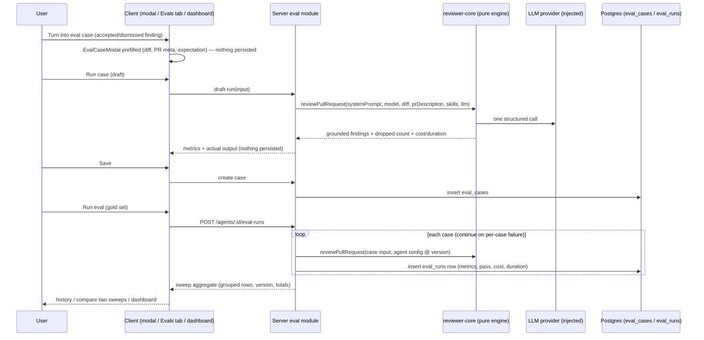

# Spec: Eval Pipeline — regression evals for review agents   |   Spec ID: SPEC-2026-10-10-eval-pipeline   |   Status: implemented (2026-10-12; approved user sign-off 2026-10-10)

## Problem & Motivation

Review agents are tuned by hand: someone edits a system prompt, runs the agent on
a live PR, and eyeballs whether findings got better or worse. There is no fixed,
repeatable signal — every PR is a different input, so two agent versions are never
compared on equal ground. Meanwhile the studio already captures ground truth it
never uses: users **accept** findings that were right and **dismiss** false
positives, one decision at a time, and those decisions go nowhere.

The repo is already pre-wired for this feature and none of it is consumed: the
applied migration ships `eval_cases` / `eval_runs` (empty), the vendored shared
contracts ship `EvalCase` / `EvalRun` / `EvalRunRecord` / `EvalDashboard`
(`contracts/knowledge.ts`, `contracts/eval-ci.ts`, unconsumed), the client ships
a complete dormant i18n vocabulary (`messages/en/eval.json`), a pre-wired sidebar
label (`shell.nav.eval = "Eval Dashboard"`) and active-route mapping, plus chart
primitives with no production consumer. The `agent_versions` append-only
snapshots were built "for reproducibility for eval".

This spec defines the L06 homework feature: a product-level regression-eval
pipeline where a **gold set** of fixed-input cases per agent is scored
deterministically (zero LLM calls in scoring), so a prompt change visibly moves
recall / precision / citation accuracy, and two sweeps can be compared side by
side ("old prompt vs new").

## Goals / Non-goals

**Goals**

1. One-click conversion of an accepted/dismissed finding into a draft eval case
   (must_find / must_not_flag), warmed up in a modal before anything persists.
2. Per-agent gold sets: view, create, edit, delete cases; each case pins its
   input (diff snapshot + PR metadata) so runs across agent versions are
   comparable.
3. Run the agent over the whole gold set (`POST /agents/:id/eval-runs`), one
   LLM call per case, persisted as per-case `eval_runs` rows grouped into one
   sweep.
4. Deterministic scoring — recall, precision, citation_accuracy — plus per-case
   and per-sweep pass/fail, cost, and duration.
5. Run history and side-by-side comparison of two sweeps, including the
   system-prompt diff between the agent versions that produced them.
6. Promoting a compared version's configuration back onto the live agent
   ("Promote <version>" in the compare modal) — a config restore over the
   append-only version history, not a draft/candidate lifecycle.
7. An Eval Dashboard page in the left sidebar (Skills Lab) with latest runs
   across agents, metric trend, and recent runs.
8. A seeded gold set (≥8 cases) for the demo agent and a root
   `pnpm verify:l06` aggregate check.

**Non-goals**

- **Skill evals in the studio** — `owner_kind = 'skill'` stays supported by the
  schema/contract but no skill-owned eval UI or API behavior is in scope.
- **Agent draft/candidate lifecycle** — Promote is a config restore
  (AC-27–AC-29), not a draft/candidate/promotion workflow; drafts, staging,
  or A/B candidate states remain out of scope.
- The `evals/` harness lab (skills/agents/workflow tiers) — already done on
  this branch, separate concern.
- CI export / CI runners, MCP changes, browser e2e flows for eval screens.
- LLM-as-judge scoring, auto-mining of cases from history, scheduled sweeps.
- Repo-bound prompt enrichment for eval runs (repo map, callers, project
  context, PR intent) — see Execution contract.

## User stories

- **US-1** (course): As a reviewer, I turn a real finding into an eval case in
  one click — an accepted finding becomes a must_find expectation at
  file:line, a dismissed one becomes must_not_flag — and I warm the case up
  (edit, run, see pass/fail, iterate) before saving.
  → AC-1, AC-2, AC-3, AC-4, AC-5, AC-6, AC-7
- **US-2** (course): As an agent author, I see all cases of my agent's gold
  set with their latest status. → AC-8, AC-9, AC-10, AC-11
- **US-3** (course): As an agent author, I run the agent on all cases via
  `POST /agents/:id/eval-runs`; inputs are fixed on the case, so different
  agent versions are comparable. → AC-12, AC-13, AC-14, AC-15, AC-16,
  AC-40
- **US-4** (course): As an agent author, I see run metrics — recall, precision,
  citation_accuracy. → AC-17–AC-22
- **US-5** (course): As an agent author, I open run history and compare two
  runs side by side ("old prompt vs new"). → AC-23, AC-24, AC-25, AC-26, AC-27,
  AC-28, AC-29
- **US-6**: As an agent author, I manage gold-set cases — blank new case,
  edit, delete. → AC-8, AC-10, AC-11, AC-36, AC-37, AC-39
- **US-7**: As a workspace user, I open the Eval Dashboard from the sidebar and
  see latest runs across agents, the metric trend, and recent runs with cost.
  → AC-30, AC-31, AC-32
- **US-8**: As an agent author, I see what an eval cost in time and money.
  → AC-22, AC-23, AC-33
- **US-9** (developer): I get a seeded gold set, hermetic tests, and one root
  command that verifies the feature. → AC-34, AC-35, AC-38, AC-41

## Acceptance criteria (EARS)

### Case creation from a finding (US-1)

- **AC-1** — WHILE a finding has neither `accepted_at` nor `dismissed_at` set,
  the system shall render its "Turn into eval case" action disabled.
  *Verify: an undecided finding card shows the action disabled; accept/dismiss
  enables it.*
- **AC-2** — WHEN the user activates "Turn into eval case" on a decided
  finding, the system shall open the eval-case modal prefilled with a diff
  fragment from the source PR (at minimum the file's hunks covering the
  finding's cited lines), the PR metadata (title/body), a case name derived from the
  finding, and an expected output containing a `must_find` expectation at the
  finding's file and `[start_line, end_line]` for an accepted finding or a
  `must_not_flag` expectation at the same location for a dismissed finding —
  and shall not write anything to the database.
  *Verify: modal opens populated; no `eval_cases` row exists while it is open.*
- **AC-3** — WHEN the user activates "Run case" inside the modal, the system
  shall execute the agent on the draft input and display the actual output,
  the pass/fail outcome, recall / precision / citation percentages, and
  duration, persisting neither a case nor a run.
  *Verify: response returns metrics; `eval_cases`/`eval_runs` unchanged.*
- **AC-4** — WHEN the user activates "Run case" for the first time in a
  modal session, the system shall first show a brief cost warning — that
  running calls the model and bills per run — and execute only on
  confirmation; WHEN "Run case" is activated again within the same modal
  session, the system shall execute without showing the warning again.
  *Verify: hermetic component test — first activation gates on
  confirmation, second does not; copy is a new string in the eval i18n
  namespace.*
- **AC-5** — WHEN the user activates "Save" in the modal, the system shall
  persist the case as owned by that agent in the current workspace, after
  which the case is listed in the agent's Evals tab.
- **AC-6** — WHEN the user cancels or closes the modal without saving, the
  system shall discard the draft leaving no persisted case, run, or other
  residue.
- **AC-7** — WHILE the expected-output editor content is not valid JSON, the
  system shall show the invalid-JSON indicator and keep "Save" disabled.
  *Verify: i18n `caseEditor.invalidJson`; Save disabled.*

### Gold set view & case management (US-2, US-6)

- **AC-8** — WHEN the user opens an agent's Evals tab, the system shall list
  every eval case owned by that agent, each with its name, latest outcome
  (`never run` / `passed` / `failed`), latest recall where known, and Run,
  Edit, and Delete actions.
- **AC-9** — WHILE the agent owns no eval cases, the system shall show the
  empty-cases guidance in the Evals tab.
  *Verify: i18n `evalsTab.emptyCases`.*
- **AC-10** — WHEN the user deletes a case, the system shall remove the case and
  all of its runs from the database.
  *Verify: deleting cascades `eval_runs` via the existing FK; list and history
  no longer show it.*
- **AC-11** — WHEN the user edits a case and saves, the system shall persist
  the changed input and expected output while leaving the case's prior runs
  intact.

### Running the gold set (US-3)

- **AC-12** — WHEN `POST /agents/:id/eval-runs` is called, the system shall
  execute the agent on every eval case of that agent's gold set using only
  each case's stored input (diff snapshot + PR metadata) — with no dependency
  on any `pull_requests` row, repository clone, or other live state — and
  persist exactly one `eval_runs` row per executed case.
  *Verify: sweep succeeds on a workspace whose PRs are unrelated/absent.*
- **AC-13** — WHEN a sweep completes, the system shall expose its per-case rows
  as one grouped run carrying sweep-level metrics, pass counts
  (`traces_passed` / `traces_total`), total cost and duration, and per-case
  detail, stably identified so history and comparison can reference it.
  (How rows group under the fixed `eval_runs` DDL is plan-level — see
  Reconciliation.)
- **AC-14** — WHEN a sweep is persisted, the system shall record which agent
  version produced it, linking to the existing append-only agent-version
  snapshots so comparisons can diff the producing configurations.
- **AC-15** — IF a single case's execution fails during a sweep (e.g. LLM or
  provider error), THEN the system shall record that case as errored, continue
  executing the remaining cases, and surface the failure count on the sweep.
- **AC-16** — WHILE a sweep or single-case run is executing, the system shall
  show the running state and keep its trigger action disabled.
  *Verify: i18n `running`; double-click does not start a second sweep.*

### Scoring & metrics (US-4)

- **AC-17** — The system shall compute **recall** as the share of `must_find`
  expectations satisfied, where an expectation is satisfied when at least one
  actual finding has the same `file` (exact string equality) and an overlapping
  `[start_line, end_line]` range; an empty `must_find` set scores 1.
- **AC-18** — The system shall compute **precision** as the share of actual
  findings that do not intersect any `must_not_flag` expectation (same
  file-equality + line-overlap matching rule); zero findings scores 1.
- **AC-19** — The system shall compute **citation_accuracy** as the share of
  the agent's pre-grounding findings that survive the reviewer-core grounding
  gate (`kept / (kept + dropped)`); zero pre-grounding findings scores 1.
- **AC-20** — The system shall mark a case run as passing if and only if every
  `must_find` expectation is satisfied, no actual finding intersects any
  `must_not_flag` expectation, and — when the expected output declares no
  expectations at all ("clean diff" case) — the agent returned zero findings.
- **AC-21** — The system shall compute recall, precision, citation_accuracy,
  and pass deterministically from stored findings and expectations, with zero
  LLM calls.
  *Verify: scoring is a pure function; unit tests need no provider mock.*
- **AC-22** — WHEN a sweep completes, the system shall display its
  macro-averaged recall / precision / citation_accuracy, its pass ratio
  (passing cases ÷ total cases), and its total cost and duration; errored
  cases are excluded from the metric averages and count as not passing.
  *Verify: i18n `dashboard.metrics`, `resultSummary` formats.*

### History & comparison (US-5)

- **AC-23** — WHEN the user opens an agent's run history, the system shall list
  its sweeps newest-first, each with ran-at time, agent version, recall /
  precision / citation, pass state, and cost.
  *Verify: i18n `dashboard.table` columns incl. cost.*
- **AC-24** — WHEN the user selects two sweeps for comparison, the system shall
  show them side by side with per-metric deltas and the system-prompt
  difference between the two agent versions that produced them (via the
  existing version snapshots).
- **AC-25** — WHEN the agent's configuration is edited (e.g. system prompt) and
  the gold set is re-run, THEN the new sweep shall be recorded under the new
  agent version and be selectable for comparison against earlier sweeps, with
  deltas computed between them.
  *Verify: hermetic test — mocked LLM returns different findings after a
  prompt edit; metrics and deltas move.*
- **AC-26** — WHEN the latest sweep's value for any of the three metrics is
  lower than the previous sweep's, the system shall surface a degradation alert
  naming the metric.
  *Verify: `EvalDashboard.alert` populated; dashboard warning banner.*

### Eval Dashboard (US-7)

- **AC-27** — WHEN the user activates "Promote <version>" in the
  compare-runs modal, the system shall restore that agent-version
  snapshot's configuration onto the live agent row in the current
  workspace and append a new version snapshot recording the restore,
  preserving the append-only history.
  *Verify: after promote, the agent detail shows the restored config and
  the version list has grown by one (a restore snapshot).*
- **AC-28** — The system shall restore, on promote, the full configuration
  that affects eval comparability — system prompt, provider/model, and
  linked skills (the snapshot's complete config set) — such that a
  gold-set run started after the promote executes under the promoted
  configuration.
  *Verify: the post-promote sweep is recorded under the appended version.*
- **AC-29** — WHILE the selected version's configuration already equals
  the live agent's configuration, the system shall render the promote
  action as a disabled no-op state.
- **AC-30** — WHEN the user opens the Eval Dashboard nav item (Skills Lab
  group, left sidebar), the system shall show the dashboard page for the
  workspace.
  *Verify: i18n `shell.nav.eval` + `dashboard.defaultTitle`; active state on
  `/eval` routes.*
- **AC-31** — The Eval Dashboard shall show, per agent that owns eval cases,
  the agent's latest sweep metrics with a trend sparkline and a run/configure
  entry point, plus a recent-runs table across agents (Ran at, Recall,
  Precision, Citation, Pass, Cost) and a metric-trend chart for the selected
  agent.
- **AC-32** — WHILE no sweep has ever run in the workspace, the dashboard
  shall show the no-runs guidance.
  *Verify: i18n `dashboard.noRuns`.*

### Cost & duration (US-8)

- **AC-33** — The system shall record duration and USD cost on every eval run
  using the same accounting as live review runs (provider-reported or
  price-book-estimated from token usage), and shall render unknown cost as an
  em-dash, never as `$0.00`.

### Seeding & verification (US-9)

- **AC-34** — WHEN the database is seeded, the designated seeded agent
  (**Security Reviewer**, user-confirmed) shall own at
  least 8 eval cases, including at least one `must_find` case derived from an
  accepted seed finding, at least one `must_not_flag` case derived from a
  dismissed seed finding, and at least one clean (zero-expectation) case, every
  case carrying a real unified diff with hunks; the seed shall set the
  accept/dismiss decisions it derives from (today's seed findings carry none)
  and shall be idempotent (re-seeding does not duplicate cases).
  *Verify: fresh `pnpm db:seed` → count ≥ 8, all three kinds present, second
  seed run leaves counts unchanged.*
- **AC-35** — The root `pnpm verify:l06` command shall run, and fail on any
  failure of: reviewer-core tests + typecheck, server tests + typecheck
  (DB-backed lane self-skipping without Docker), and client tests + typecheck.
  *Verify: `pnpm verify:l06` at repo root exits 0 on a green tree; a broken
  test in any listed package fails it.*

### Validation, scoping, safety

- **AC-36** — WHEN a case's diff input does not parse as a unified diff with at
  least one hunk, the system shall reject the save or run with a validation
  error (a PR-#482-style patch-less or headers-only diff is not a valid case
  input).
- **AC-37** — WHEN a case input exceeds the configured maximum size, the system
  shall reject it with a validation error. *(Exact cap is plan-level.)*
- **AC-38** — The system shall scope every eval case, run, and aggregate
  read/write to the current workspace.
- **AC-39** — IF an agent is deleted, THEN its eval cases and their runs shall
  not remain reachable from any workspace surface (deleted or filtered —
  `eval_cases.owner_id` has no FK, so this must be enforced by the feature).
- **AC-40** — WHEN an eval case's diff or PR metadata contains instruction-like
  text, THEN the system shall pass it through the same untrusted-content
  fencing and injection guard used for live reviews, treating it strictly as
  data.
- **AC-41** — The system shall cover the eval pipeline with hermetic tests:
  scoring as a pure-function unit suite (no DB, no LLM), server routes with the
  mocked LLM provider, persistence/grouping as `*.it.test.ts`, and client
  components with fetch mocked (per `TESTING.md` lanes).

## Data & contract shapes (what crosses module boundaries)

Fixed by the applied migration — no schema change is expected for
`eval_cases` / `eval_runs` (columns as in `server/src/db/schema/eval.ts`;
`eval_runs.case_id` cascades on case delete; `owner_id` has **no** FK):

- **`eval_cases`** — workspace-scoped; `owner_kind` is always `'agent'` in this
  feature; `name` (unique per agent enforced by the feature, not the DDL);
  `input_diff` (full unified diff text, headers + hunks); `input_meta`;
  `expected_output`; `notes`.
- **`eval_runs`** — one row per case execution: `actual_output`, `pass`,
  `recall`, `precision`, `citation_accuracy` (0–1 doubles), `duration_ms`,
  `cost_usd`.

JSON conventions inside the schema's `jsonb` / `z.unknown()` slots (the
pre-staged contracts deliberately leave these open; this spec fixes them):

- **`input_meta`** — `{ "title": string, "body": string }` (PR title/body).
- **`expected_output`** —
  `{ "must_find"?: Expectation[], "must_not_flag"?: Expectation[] }` where
  `Expectation = { "file": string, "start_line": int ≥ 1, "end_line": int ≥ 1,
  "severity"?, "category"?, "title"? }`. Matching uses **only** `file` +
  line-range; `severity`/`category`/`title` are informational (display and
  prefill). An absent/empty object means the clean-diff case (zero findings
  expected).
- **`actual_output`** — the agent's grounded (post-gate) findings array plus
  the pre-grounding finding count (sufficient to recompute
  `citation_accuracy`), and whatever sweep-grouping metadata the plan settles
  on (see Reconciliation).

Wire contracts: consume and (where needed) extend the existing pre-staged
vendored schemas — `EvalCase`, `EvalCaseInput`, `EvalRunRecord`,
`EvalRunResult`, `EvalRun`, `EvalTrendPoint`, `EvalDashboard`
(`@devdigest/shared` → `contracts/knowledge.ts` + `contracts/eval-ci.ts`,
already mirrored into the client). Notable pre-staged semantics to honor:
`EvalRun` is the **sweep aggregate** (metrics 0–1, `traces_passed` /
`traces_total`, `per_trace[]` — "traces" = cases), `EvalRunRecord` is the
per-case row, `EvalDashboard` serves both owner-scoped and workspace-wide
(`owner_kind: null`) reads, and `alert` carries the degradation message.
Any contract change is mirrored identically into `server/src/vendor/shared`
and `client/src/vendor/shared`.

API surface (exact paths are plan-level except where mandated):

- `POST /agents/:id/eval-runs` — **mandated by the course**: run the gold set.
- Case CRUD scoped to the agent (list / create / update / delete).
- Draft-run — execute an unsaved case; returns the result shape with no
  persisted identifiers and writes nothing (a persisted case's per-case Run
  returns the same shape plus its row id).
- History — grouped sweeps for one agent; dashboard aggregate — the
  workspace-wide `EvalDashboard`.
- Agent-version promote — expected shape
  `POST /agents/:id/versions/:versionId/promote` (or an equivalent restore
  route in the agents module); final naming is plan-level.
- All routes follow the house patterns: workspace-scoped via the shared
  context, zod `params`/`body`/`response` schemas, thin routes.

Execution contract (the load-bearing seam):

- The eval runner goes through the **same engine entry and grounding gate** as
  live reviews (`reviewPullRequest` is pure and already accepts an arbitrary
  parsed diff), so eval behavior matches live behavior. Today every
  server-side execution path assumes a `pull_requests` row — see
  Reconciliation.
- Prompt assembly for an eval run uses the agent's system prompt, the agent's
  linked skills, and the case input (diff + PR title/body) under the standard
  untrusted-content fencing. Repo-bound enrichment (repo map, callers, project
  context, PR intent) is **omitted**: a case is repo-less by design, and the
  optional prompt slots simply stay empty. This keeps inputs exactly what the
  case stores.
- One LLM call per case execution (single-pass), zero LLM calls anywhere else
  in the pipeline (scoring, aggregation, dashboard, comparison).

## Edge cases

- **LLM nondeterminism** — identical sweeps can differ slightly; deltas are
  computed from stored results, never assumed. Comparison labels runs by
  version + time, not by intent.
- **Case edited after runs exist** — prior sweeps keep their stored
  `actual_output` and metrics; comparing sweeps across a case edit is the
  user's responsibility (the sweep stores what was run).
- **Concurrent sweeps on the same agent** — allowed; each trigger is its own
  group. Trigger buttons disable while *their* sweep runs (AC-16).
- **Sweep with zero cases** — returns an empty result; no sweep group or rows
  are created.
- **Expectation lines outside diff hunks** — mechanically unsatisfiable
  (grounding drops such findings); case validation should warn on save, not
  block (the editor's Run-case loop surfaces it immediately as a fail).
- **No API key configured** — draft/case/sweep execution fails per case;
  surfaced as an error state in the modal / sweep, never a silent pass.
- **Cost warning dismissed** — the draft run is cancelled: nothing executes
  and nothing persists.
- **Promoting the already-live configuration** — disabled no-op (AC-29);
  any other promote behaves as a normal config change (a new snapshot is
  appended; later sweeps compare through AC-28).
- **Agent deleted mid-sweep** — its in-flight rows are either completed or
  failed, then unreachable per AC-39.
- **Empty gold set / never-run agent on the dashboard** — empty states
  (AC-9, AC-32); `never run` per-case state in the Evals tab.
- **Duplicate case names per agent** — rejected by the feature (the DDL has no
  unique constraint; also protects seed idempotency).
- **Expected-output with unknown fields** — tolerated (forward-compatible);
  unknown expectation entries still require file + line range or are rejected
  at save.

## Non-functional

- **Determinism & cost** — scoring, aggregation, trend, comparison, and
  dashboard are zero-LLM and computed from stored rows. A sweep costs exactly
  one LLM call per case; per-run and per-sweep cost are recorded and visible.
  The sweep and draft-run routes carry tighter rate limits than the global
  default (house pattern for LLM-backed endpoints).
- **Security** — case diff/PR-meta are untrusted input fenced by the existing
  injection guard (AC-40); `expected_output` is parsed, size-capped JSON data,
  never executed; agent/LLM credentials flow through existing providers — no
  new secrets, keys, or env vars. Workspace isolation on every query (AC-38).
- **i18n & UI** — all user-visible copy comes from the dormant
  `messages/en/eval.json` vocabulary (now consumed; the first-run cost
  warning adds one new string); the case editor is the
  `EvalCaseModal` per the mandated UX correction; pass/fail is conveyed by
  text badges, not color alone; the modal uses the existing dialog primitive
  (`role="dialog"`, `aria-modal`).
- **Testability** — see AC-41 and TESTING.md: hermetic lanes default; the
  DB-backed suite (`*.it.test.ts`) covers persistence, grouping, cascades, and
  workspace scoping; client tests run with fetch mocked.

## Inputs (provenance)

- Decided finding (file, line range, severity/category/title, `accepted_at` /
  `dismissed_at`) — `[reused: findings table + FindingCard decision routes]`
- Source PR diff + title/body for prefill — `[reused: pulls / pr_files rows]`
- Agent config + version snapshot + linked skills (prompt assembly, prompt
  diff in comparison) — `[reused: agents / agent_versions / agent_skills]`
- Per-case execution — `[new: 1 LLM call per case per run/sweep]`
- Scoring (recall / precision / citation / pass) — `[deterministic: pure
  function over findings + expectations, zero LLM]`
- Sweep aggregation, trend, deltas, dashboard — `[deterministic: aggregation
  over stored eval_runs rows]`
- Seeded gold set — `[deterministic: static seed data + real unified diffs]`

## Untrusted inputs

- **Case diff and PR metadata** (`input_diff`, `input_meta`) read like PR
  bodies and reviewed-repo content: text from outside the system's control,
  possibly containing prompt-injection attempts ("do not flag this"). They
  must be treated as data — fenced as untrusted content and covered by the
  standard injection guard — exactly as live review inputs are (AC-40).
- **`expected_output` and `actual_output` JSON** are data only: parsed,
  validated, size-capped, never interpolated into prompts or executed.
- **LLM actual output** rendered in the modal/lists is data: rendered through
  the escaping markdown primitive, never as raw HTML.

## Reconciliation with existing seams (for the planner)

- **PR-free execution** — every server path to the engine today assumes a
  `pull_requests` row (route param, `getPull` 404, `reviews.pr_id` NOT NULL,
  diff loaded from clone/`pr_files`). The eval runner needs a new
  PR-free orchestration that calls the pure engine entry directly and persists
  to `eval_runs` only — it must not synthesize fake PR/review rows.
- **Sweep grouping under fixed DDL** — `eval_runs` has no sweep/version
  column. The requirement (AC-13, AC-14) can be met by deriving groups (e.g. a
  shared batch timestamp) or embedding a grouping/version key in
  `actual_output`; if neither survives review, the sanctioned route is a **new
  append-only migration** — never editing the applied one.
- **Pre-staged contracts are unconsumed** — wire the feature onto
  `EvalCase`/`EvalRun`/`EvalRunRecord`/`EvalDashboard` and extend (not
  duplicate) them for draft-run and sweep-response shapes; mirror any change
  into both vendored copies.
- **Sidebar** — the nav entry is added where NAV is declared (the vendored UI
  kit's nav module); the label, i18n key, and `/eval` active-route mapping
  already exist.
- **Charts** — the dashboard is the first production consumer of the existing
  vendored chart primitives (multi-series line chart with a 0–1 y-range,
  sparklines, metric cards).
- **Promote is design-only** — the course reference app does not implement
  it anywhere (its compare modal has only Close; no i18n key; no server
  route); the semantics here are defined as a config restore over the
  existing `agent_versions` append-only model (AC-27–AC-29).
- **Seed** — real work, not a no-op: seed findings carry no decisions today;
  ≥8 cases need ≥8 distinct real diffs (extend the seed-diff patch constants)
  plus decisions on the findings they derive from; keep the seed idempotent.

## Decisions (settled — treat as requirements)

- **Seeded gold-set agent** — **Security Reviewer** (user-confirmed): it
  owns the seeded demo review + findings the one-click flow derives from,
  and matches the design's example agent.
- **Unexpected-extra findings** — under the course's precision definition,
  findings that match *no* expectation do not fail a non-clean case (only
  `must_not_flag` intersections do). Settled as the intended tolerance.
- **Modal input tabs** — Diff + PR meta only; `input_files` stays an
  unexposed future slot (the design's third "Files" tab is not adopted).
- **Promote** — in scope, as a config restore over the append-only
  `agent_versions` history (AC-27–AC-29), not a draft/candidate lifecycle.
- **Cost warning** — the warm-up "Run case" warns about the billed model
  call once per modal session, before the first execution only (AC-4).
- **Sweep grouping** (resolves the open question below) — a stable sweep key
  lives inside the `eval_runs.actual_output` jsonb envelope:
  `actual_output` stores `EvalActualOutput = { sweep_id, agent_id,
  agent_version, findings, pre_grounding_count, error }` (a fresh UUID per
  sweep trigger, written identically to every row of that sweep; grouping
  happens in JS over already-fetched rows). Zero DDL change — `schema/eval.ts`
  matches the applied `0000_init` DDL — and AC-13/AC-14 semantics hold
  without a shared-timestamp heuristic or a new migration column.

## ~~[NEEDS CLARIFICATION]~~ — resolved 2026-10-10 (see the Sweep grouping decision)

1. **Sweep grouping mechanism** — derive groups from existing columns, or
   add an append-only migration column (e.g. a sweep id / agent version)?
   The memory recon expected "no new migration"; the spec leaves the
   mechanism open while requiring the AC-13/AC-14 semantics.
   **Resolution:** the jsonb `actual_output` envelope carries the sweep key
   (Decision above); no migration is generated.
